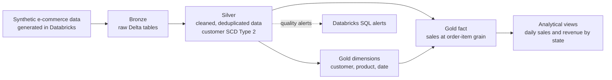

# E-commerce Data Warehouse on Databricks

An end-to-end data modeling portfolio project that builds an e-commerce data warehouse on Databricks with Delta Lake. It demonstrates a Bronze → Silver → Gold medallion architecture, incremental transformations, customer history tracking with SCD Type 2, and a dimensional model for sales analysis.

The source data is synthetic and generated by the project notebooks. This repository is for learning and demonstration; it does not contain production data.

## What this project demonstrates

- Generating synthetic e-commerce source data in the Bronze layer with PySpark, including nulls, duplicates, inconsistent types, and multiple date formats.
- Cleaning and standardizing Bronze data into Silver with SQL.
- Using Delta tables, `MERGE INTO`, row hashes, and deterministic deduplication for incremental, idempotent processing.
- Tracking customer history with a Type 2 slowly changing dimension (SCD2).
- Building Gold dimensions and an item-grain sales fact table for analytical queries.
- Defining Databricks SQL alerts for selected Silver-layer quality checks.

## Architecture



The Silver customer history is carried into Gold for time-aware joins. Gold also provides a current-customer snapshot for analyses that do not require historical customer attributes.

## Data model

| Layer | Main objects | Purpose |
| --- | --- | --- |
| Bronze | `products`, `customers`, `orders`, `order_items` | Raw, synthetic source data with deliberately varied values. |
| Silver | `orders_clean`, `order_items_clean`, `products_clean`, `dim_customer_scd` | Standardized and deduplicated data; customer history maintained as SCD Type 2. |
| Gold | `dim_tempo`, `dim_produto`, `dim_cliente`, `dim_cliente_scd`, `fact_vendas`, `fact_vendas_current` | Dimensional model for reporting and historical analysis. |
| Gold views | `vw_vendas_diarias`, `vw_receita_por_estado` | Example daily sales and state-level revenue queries. |

`fact_vendas` is modeled at the order-item grain and links to date, product, and the time-valid customer dimension.

## Repository layout

```text
jobs/
└── e-commerce data warehouse.yaml    # Databricks SQL job resource; workspace-specific IDs
models/
├── silver/                           # Silver SQL query notebooks
└── gold/                             # Gold SQL query notebooks
notebooks/
├── bronze_layer.ipynb                # Generates synthetic Bronze data
├── silver_layer.ipynb                # Builds and updates Silver tables
└── gold_layer.ipynb                  # Builds Gold dimensions, facts, and views
tests/
└── sql/alerts/                       # Databricks SQL alert definitions
```

The `models/silver/` and `models/gold/` directories contain `.dbquery.ipynb` files with SQL queries that correspond to the Silver and Gold transformations.

## Run the notebooks

You need a Databricks workspace with Delta Lake support and permission to create the project schemas and tables. The Bronze notebook installs `Faker` and `pyspark` in its first cell.

1. Import or open this repository in your Databricks workspace.
2. Review the catalog and schema settings in the notebooks. The default catalog is `workshop_modelagem`.
3. If your workspace does not use Unity Catalog, set `CATALOG = None` in `notebooks/bronze_layer.ipynb` and remove or adapt the `USE CATALOG workshop_modelagem` statements in the Silver and Gold notebooks.
4. Run the notebooks in order:
   1. `notebooks/bronze_layer.ipynb`
   2. `notebooks/silver_layer.ipynb`
   3. `notebooks/gold_layer.ipynb`
5. Query the Gold outputs, for example:

```sql
SELECT *
FROM gold.vw_vendas_diarias
ORDER BY data;

SELECT *
FROM gold.vw_receita_por_estado
ORDER BY data, state;

SELECT COUNT(*)
FROM gold.fact_vendas;
```

Bronze regenerates the synthetic source data when rerun. Silver and Gold transformations are designed to be idempotent, but validate behavior in your own Databricks runtime and workspace configuration.

## Databricks SQL job

The job resource is in `jobs/e-commerce data warehouse.yaml`. It orchestrates SQL tasks and dependencies using a Databricks SQL Warehouse.

This file is not ready to deploy unchanged to another workspace: its `query_id` and `warehouse_id` values are workspace-specific. Create the SQL queries in your workspace using the corresponding notebooks under `models/silver/` and `models/gold/`, then replace those IDs in the YAML. If you do not use Unity Catalog or a SQL Warehouse, run the notebooks in the order above instead.

The current schedule in the YAML is daily at 00:05:50 UTC. Review or pause it before deploying the job in a workspace where that schedule is not intended.

## How this was built

Built directly, file by file, in Databricks notebooks and SQL — no prompt sequence and no
coding agent involved. It is the counterpart to
[grid_intelligence_databricks](https://github.com/rafacorte1/grid_intelligence_databricks),
where the same domain rigor — explicit business rules, declared grains, acceptance checks
before anything counts as done — was carried through a written specification, an AI coding
agent for the implementation and human validation. Same standards, two build modes.

## Limitations

- The project uses generated data rather than a real source system or production workload.
- Workspace-specific catalog, SQL query, and warehouse configuration is required.
- This repository does not include an automated CI pipeline or a portable, ready-to-deploy Databricks bundle.
- No license file is included. Ask the repository owner before reusing or redistributing the project.
